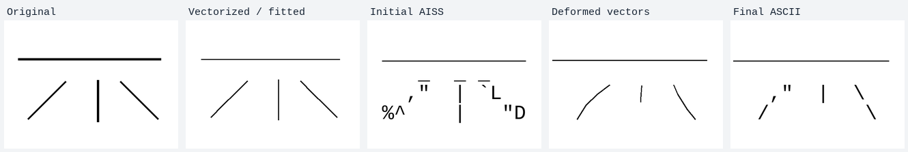
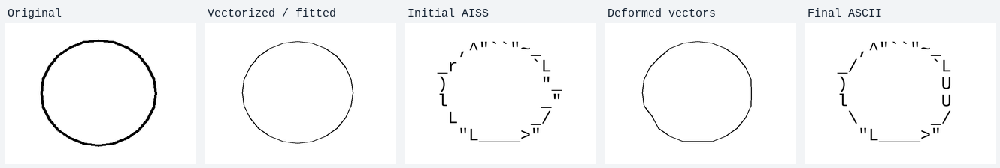
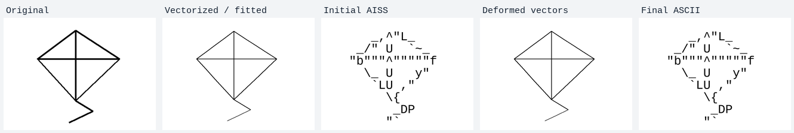
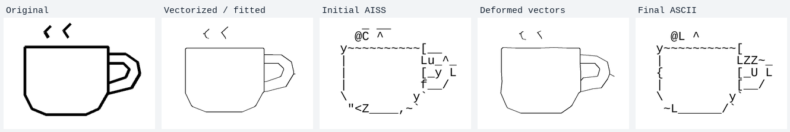
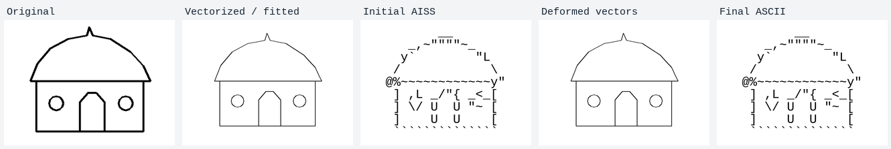
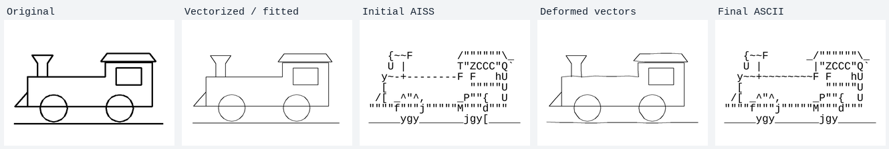
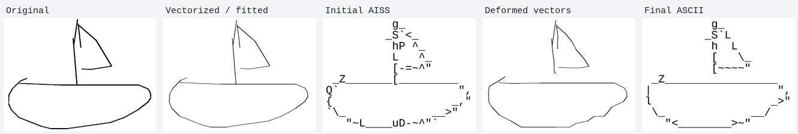
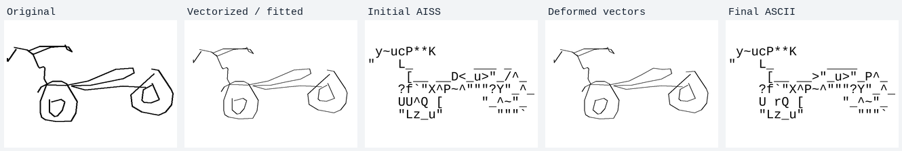

# ASCII reproduction gallery

Each strip shows the source, fitted vector drawing, initial AISS rendering, best deformed drawing and final ASCII. Open the text links for the exact fixed-width grids. The full set below includes every selected Quick, Draw! sketch.

## Controlled drawings

### Lines

The final rendition aligns the long horizontal stroke into one row. The short diagonals still break at glyph boundaries.

[Exact ASCII](results/main/lines/final.txt) · [Initial ASCII](results/main/lines/initial.txt) · [Run](results/main/lines/run.json)

### Ring

The loop remains recognizable and the interior stays blank. Several glyph seams break the visible contour.

[Exact ASCII](results/main/ring/final.txt) · [Initial ASCII](results/main/ring/initial.txt) · [Run](results/main/ring/run.json)

### Kite

The silhouette and tail are visible. The search stalled, and the central stroke remains a row of punctuation and letters.

[Exact ASCII](results/main/kite/final.txt) · [Initial ASCII](results/main/kite/initial.txt) · [Run](results/main/kite/run.json)

### Mug

The raster fixture keeps the bowl and negative space. The steam and the two handle outlines show clutter.

[Exact ASCII](results/main/mug/final.txt) · [Raster stages](results/main/mug/preprocessing.png) · [Run](results/main/mug/run.json)

## Paper analogues

### Domed chapel

This independently drawn analogue tests the dome and small window shapes from Figures 9–10. The baseline width stalls, while the 24-column experiment gives the openings more space.

[Exact ASCII](results/main/domed-chapel/final.txt) · [24-column panel](results/sweep-24-0/domed-chapel/panel.png) · [Run](results/main/domed-chapel/run.json)

### Steam engine

This independently drawn Figure 16 analogue retains the cab, chimney and rail. The wheels partially merge into the body.

[Exact ASCII](results/main/steam-engine/final.txt) · [Run](results/main/steam-engine/run.json)

## Quick, Draw! examples

### Sailboat

The hull straightens and the sail remains recognizable. The mast and small gaps at the hull are still broken.

[Exact ASCII](results/main/sailboat-6420399212462080/final.txt) · [Run](results/main/sailboat-6420399212462080/run.json)

### Bicycle

The frame remains visible, but the wheel rims and overlapping details fragment into punctuation and letters.

[Exact ASCII](results/main/bicycle-5122624227115008/final.txt) · [Run](results/main/bicycle-5122624227115008/run.json)

## Complete Quick, Draw! set

The “Recognized” column records the game's flag for the input. The category is the drawing prompt. Each panel credits the source through the sample manifest. The drawings were contributed by *Quick, Draw!* players and released by Google, Inc. under [CC BY 4.0](https://creativecommons.org/licenses/by/4.0/). The project fits, deforms and renders these adaptations. [Source manifest](quickdraw-manifest.json)

| Category | Sample ID | Recognized | Comparison | Exact text | Metadata |
| --- | --- | --- | --- | --- | --- |
| apple | 6420579601088512 | No | [Panel](results/main/apple-6420579601088512/panel.png) | [Initial](results/main/apple-6420579601088512/initial.txt) · [Final](results/main/apple-6420579601088512/final.txt) | [Run](results/main/apple-6420579601088512/run.json) |
| apple | 4986110117675008 | Yes | [Panel](results/main/apple-4986110117675008/panel.png) | [Initial](results/main/apple-4986110117675008/initial.txt) · [Final](results/main/apple-4986110117675008/final.txt) | [Run](results/main/apple-4986110117675008/run.json) |
| apple | 6489082920173568 | Yes | [Panel](results/main/apple-6489082920173568/panel.png) | [Initial](results/main/apple-6489082920173568/initial.txt) · [Final](results/main/apple-6489082920173568/final.txt) | [Run](results/main/apple-6489082920173568/run.json) |
| apple | 4587619411296256 | Yes | [Panel](results/main/apple-4587619411296256/panel.png) | [Initial](results/main/apple-4587619411296256/initial.txt) · [Final](results/main/apple-4587619411296256/final.txt) | [Run](results/main/apple-4587619411296256/run.json) |
| bicycle | 6426650621247488 | Yes | [Panel](results/main/bicycle-6426650621247488/panel.png) | [Initial](results/main/bicycle-6426650621247488/initial.txt) · [Final](results/main/bicycle-6426650621247488/final.txt) | [Run](results/main/bicycle-6426650621247488/run.json) |
| bicycle | 5122624227115008 | Yes | [Panel](results/main/bicycle-5122624227115008/panel.png) | [Initial](results/main/bicycle-5122624227115008/initial.txt) · [Final](results/main/bicycle-5122624227115008/final.txt) | [Run](results/main/bicycle-5122624227115008/run.json) |
| bicycle | 5694967496310784 | Yes | [Panel](results/main/bicycle-5694967496310784/panel.png) | [Initial](results/main/bicycle-5694967496310784/initial.txt) · [Final](results/main/bicycle-5694967496310784/final.txt) | [Run](results/main/bicycle-5694967496310784/run.json) |
| bicycle | 5269601967407104 | No | [Panel](results/main/bicycle-5269601967407104/panel.png) | [Initial](results/main/bicycle-5269601967407104/initial.txt) · [Final](results/main/bicycle-5269601967407104/final.txt) | [Run](results/main/bicycle-5269601967407104/run.json) |
| cat | 5201136883597312 | Yes | [Panel](results/main/cat-5201136883597312/panel.png) | [Initial](results/main/cat-5201136883597312/initial.txt) · [Final](results/main/cat-5201136883597312/final.txt) | [Run](results/main/cat-5201136883597312/run.json) |
| cat | 4647694628814848 | Yes | [Panel](results/main/cat-4647694628814848/panel.png) | [Initial](results/main/cat-4647694628814848/initial.txt) · [Final](results/main/cat-4647694628814848/final.txt) | [Run](results/main/cat-4647694628814848/run.json) |
| cat | 6411036099870720 | Yes | [Panel](results/main/cat-6411036099870720/panel.png) | [Initial](results/main/cat-6411036099870720/initial.txt) · [Final](results/main/cat-6411036099870720/final.txt) | [Run](results/main/cat-6411036099870720/run.json) |
| cat | 6648784836624384 | No | [Panel](results/main/cat-6648784836624384/panel.png) | [Initial](results/main/cat-6648784836624384/initial.txt) · [Final](results/main/cat-6648784836624384/final.txt) | [Run](results/main/cat-6648784836624384/run.json) |
| fish | 6591076297080832 | Yes | [Panel](results/main/fish-6591076297080832/panel.png) | [Initial](results/main/fish-6591076297080832/initial.txt) · [Final](results/main/fish-6591076297080832/final.txt) | [Run](results/main/fish-6591076297080832/run.json) |
| fish | 6721582066040832 | Yes | [Panel](results/main/fish-6721582066040832/panel.png) | [Initial](results/main/fish-6721582066040832/initial.txt) · [Final](results/main/fish-6721582066040832/final.txt) | [Run](results/main/fish-6721582066040832/run.json) |
| fish | 5385703221362688 | Yes | [Panel](results/main/fish-5385703221362688/panel.png) | [Initial](results/main/fish-5385703221362688/initial.txt) · [Final](results/main/fish-5385703221362688/final.txt) | [Run](results/main/fish-5385703221362688/run.json) |
| fish | 6087042607874048 | No | [Panel](results/main/fish-6087042607874048/panel.png) | [Initial](results/main/fish-6087042607874048/initial.txt) · [Final](results/main/fish-6087042607874048/final.txt) | [Run](results/main/fish-6087042607874048/run.json) |
| house | 5054419760578560 | Yes | [Panel](results/main/house-5054419760578560/panel.png) | [Initial](results/main/house-5054419760578560/initial.txt) · [Final](results/main/house-5054419760578560/final.txt) | [Run](results/main/house-5054419760578560/run.json) |
| house | 6190295400054784 | Yes | [Panel](results/main/house-6190295400054784/panel.png) | [Initial](results/main/house-6190295400054784/initial.txt) · [Final](results/main/house-6190295400054784/final.txt) | [Run](results/main/house-6190295400054784/run.json) |
| house | 4774272331415552 | Yes | [Panel](results/main/house-4774272331415552/panel.png) | [Initial](results/main/house-4774272331415552/initial.txt) · [Final](results/main/house-4774272331415552/final.txt) | [Run](results/main/house-4774272331415552/run.json) |
| house | 5156103178420224 | No | [Panel](results/main/house-5156103178420224/panel.png) | [Initial](results/main/house-5156103178420224/initial.txt) · [Final](results/main/house-5156103178420224/final.txt) | [Run](results/main/house-5156103178420224/run.json) |
| sailboat | 6420399212462080 | Yes | [Panel](results/main/sailboat-6420399212462080/panel.png) | [Initial](results/main/sailboat-6420399212462080/initial.txt) · [Final](results/main/sailboat-6420399212462080/final.txt) | [Run](results/main/sailboat-6420399212462080/run.json) |
| sailboat | 6483107060383744 | Yes | [Panel](results/main/sailboat-6483107060383744/panel.png) | [Initial](results/main/sailboat-6483107060383744/initial.txt) · [Final](results/main/sailboat-6483107060383744/final.txt) | [Run](results/main/sailboat-6483107060383744/run.json) |
| sailboat | 6750275354230784 | Yes | [Panel](results/main/sailboat-6750275354230784/panel.png) | [Initial](results/main/sailboat-6750275354230784/initial.txt) · [Final](results/main/sailboat-6750275354230784/final.txt) | [Run](results/main/sailboat-6750275354230784/run.json) |
| sailboat | 6740418265874432 | No | [Panel](results/main/sailboat-6740418265874432/panel.png) | [Initial](results/main/sailboat-6740418265874432/initial.txt) · [Final](results/main/sailboat-6740418265874432/final.txt) | [Run](results/main/sailboat-6740418265874432/run.json) |

## Additional runs

[Width and seed sweep](results/sweep.json) · [Single-setting ambiguity experiments](results/ambiguities.json) · [Figure 7 placement probes and initial move counts](results/probes.json) · [Author portrait numeric run](results/author-source-run.json)

The author portrait comes from the Figure 12 supplement. Its source and rendered panels are retained in the local reproduction directory. [Author comparison](https://ttwong12.github.io/papers/asciiart/queen/queen.htm) · [Reference manifest](author-reference.json)
